<div align="center">

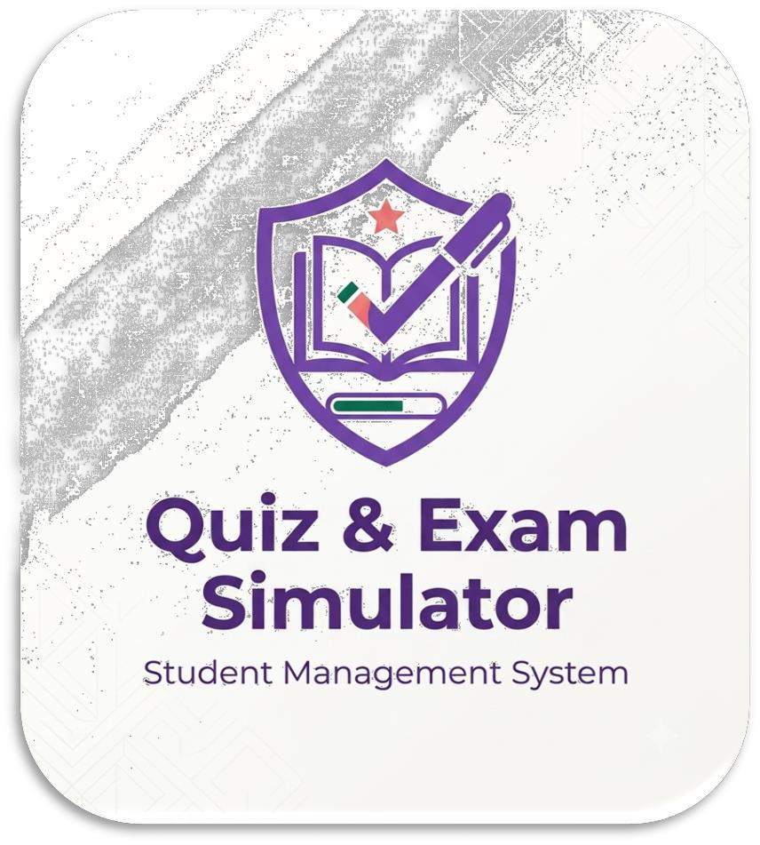

# Quiz & Exam Simulator

### Student Management System · Project Java-2026

A desktop-based quiz and examination platform built in **Java** using the **Swing** framework.


</div>

| | |
|---|---|
| **University** | National University of Technology (NUTECH), Main I.J.P Road, Sector I-12, Islamabad |
| **Department** | Computer Science |
| **Semester** | Spring 2026 |
| **Program** | Computer Science |
| **Course** | OOP Theory (CS122) |

### 👥 Submitted By

| Name | Registration No. |
|---|---|
| Abdul Rafay Akhtar | F25605217 |
| Madeeha | F25605206 |
| Urba Usman | F25605245 |
| Hina Waheed Cheema | F25605226 |

### 👨‍🏫 Submitted To

| Name | Role |
|---|---|
| Asfand Yar | Teacher |

---

## 📑 Table of Contents

1. [Introduction](#1-introduction)
2. [Objectives](#2-objectives-of-the-project)
3. [Programming Concepts Used](#3-programming-concepts-used)
4. [System Description](#4-system-description)
5. [Algorithms](#5-algorithms)
6. [Implementation Details](#6-implementation-details)
7. [Installation & How to Run](#7-installation--how-to-run)
8. [Sample Output](#8-sample-output)
9. [Conclusion](#9-conclusion)
10. [Future Enhancements](#10-future-enhancements)

---

## 1. Introduction

The **Quiz & Exam Simulator** is a desktop-based application developed in **Java** using the **Swing** framework. It provides a complete platform for conducting online quizzes and examinations in an educational environment. The application serves two primary user roles: **Teachers** and **Students**.

- **Teachers** can manage students, create questions manually or by importing files, and view detailed performance reports.
- **Students** can log in, select subjects based on their enrolled semester, take quizzes in different modes, and track their performance history.

The project demonstrates the practical implementation of core Object-Oriented Programming concepts including **Inheritance**, **Polymorphism**, **Encapsulation**, and **Abstraction**. It also incorporates **file handling** for data persistence using Java Serialization, **exception handling** for robust error management, and **GUI development** using Swing components.

---

## 2. Objectives of the Project

1. To provide a user-friendly platform for conducting quizzes and exams.
2. To allow teachers to manage students and questions efficiently.
3. To allow students to take quizzes in different modes.
4. To provide instant feedback on quiz performance.
5. To maintain quiz history for performance tracking.
6. To demonstrate the application of Object-Oriented Programming concepts.
7. To implement data persistence using file handling.
8. To create a professional GUI using Java Swing.

---

## 3. Programming Concepts Used

### 3.1 Object-Oriented Programming (OOP) Concepts

#### 3.1.1 Inheritance
Inheritance allows a class to acquire properties and methods of another class.

- `Person` is an abstract parent class. `Student` and `Teacher` extend `Person`.
- `QuizSession` is an abstract parent class. `PracticeMode`, `ExamMode`, and `SurvivalMode` extend `QuizSession`.

#### 3.1.2 Polymorphism
Polymorphism means "many forms".

- **Compile-time polymorphism (method overloading):** the `Question` class has two constructors.
- **Runtime polymorphism (method overriding):** each quiz mode overrides the `submitAnswer()` method differently.

#### 3.1.3 Encapsulation
Encapsulation hides internal data and exposes only necessary methods.

- All fields are declared `private` or `protected`.
- Access is provided through public getters and setters.

#### 3.1.4 Abstraction
Abstraction hides implementation details and shows only essential features.

- Abstract classes: `Person`, `QuizSession`.
- Abstract methods force child classes to provide an implementation.

### 3.2 Interfaces Used

| Interface | Implemented By | Purpose |
|---|---|---|
| `Gradable` | `Student` | Calculate score, get grade, check pass/fail |
| `Reportable` | `Student` | Generate formatted reports |
| `Serializable` | `Person`, `Student`, `Teacher`, `Question`, etc. | File I/O persistence |

### 3.3 Collections Framework Used

| Data Structure | Used In | Purpose |
|---|---|---|
| `ArrayList` | `Student.quizHistory` | Store quiz results dynamically |
| `ArrayList` | `QuestionBank.subjects` | Store all 15 subjects |
| `HashMap` | `StudentDatabase.studentsByRegNumber` | Fast O(1) lookup by registration number |
| `HashMap` | `QuestionBank.questionsBySubjectAndDifficulty` | Fast lookup by subject + difficulty |

### 3.4 File Handling (Serialization)

- Data is **saved** using Java Serialization via `ObjectOutputStream`.
- Data is **loaded** using Deserialization via `ObjectInputStream`.
- Files are stored in the `data/` folder as `students.ser` and `questions.ser`.

### 3.5 Exception Handling

| Exception | Handling |
|---|---|
| `IOException` | File reading/writing errors |
| `ClassNotFoundException` | Serialization version mismatch |
| `NullPointerException` | Prevented by null checks |
| `NumberFormatException` | Prevented by input validation |

---

## 4. System Description

### 4.1 User Roles

#### 👨‍🏫 Teacher
- Login using **Teacher ID** and **Password**.
- Add students with Registration Number, Name, and Semester.
- Delete students from the system.
- Add questions manually with subject, difficulty, options, correct answer, and hint.
- Import questions from **CSV** or **TXT** files.
- View detailed reports of any student.
- Export student reports to text files.

#### 🎒 Student
- Login using **Registration Number** and **Full Name**.
- Select semester (1st or 2nd).
- Select subject from semester-specific subjects.
- Select exam mode (Practice, Exam, Survival).
- Select difficulty level (Easy, Medium, Hard).
- Take quizzes with time limits.
- View quiz history and detailed performance reports.

### 4.2 Quiz Modes

#### 📘 Practice Mode
- 5 minutes time limit.
- Hints available.
- A wrong answer stays on the same question.
- Unlimited attempts.

#### 📝 Exam Mode
- Time limit: Easy = 5 min, Medium = 4 min, Hard = 3 min.
- No hints.
- One attempt only.
- Auto-submit when time expires.

#### ❤️ Survival Mode
- Time limit: Easy = 7.5 min, Medium = 6 min, Hard = 5 min.
- No hints.
- 3 lives.
- Quiz ends after 3 wrong answers.

### 4.3 Difficulty Levels

| Difficulty | Exam Mode Time | Survival Mode Time |
|---|---|---|
| Easy | 5 minutes | 7.5 minutes |
| Medium | 4 minutes | 6 minutes |
| Hard | 3 minutes | 5 minutes |

### 4.4 Subjects Covered

#### Semester 1

| Code | Subject Name | Type |
|---|---|---|
| CS101 | Programming Fundamental | Theory |
| CS101L | Programming Fundamental | Lab |
| MATH101 | Calculus & Analytical Geometry | Theory |
| CS102 | Discrete Structures | Theory |
| CS103 | Information & Communication Technologies | Theory |
| CS103L | Information & Communication Technologies | Lab |
| ENG101 | Functional English | Theory |

#### Semester 2

| Code | Subject Name | Type |
|---|---|---|
| CS201 | Object Oriented Programming | Theory |
| CS201L | Object Oriented Programming | Lab |
| MATH201 | Linear Algebra | Theory |
| MATH202 | Multivariable Calculus | Theory |
| CS202 | Database System | Theory |
| CS202L | Database System | Lab |
| CS203 | Digital Logic Design | Theory |
| CS203L | Digital Logic Design | Lab |

---

## 5. Algorithms

### 5.1 Login Process Algorithm

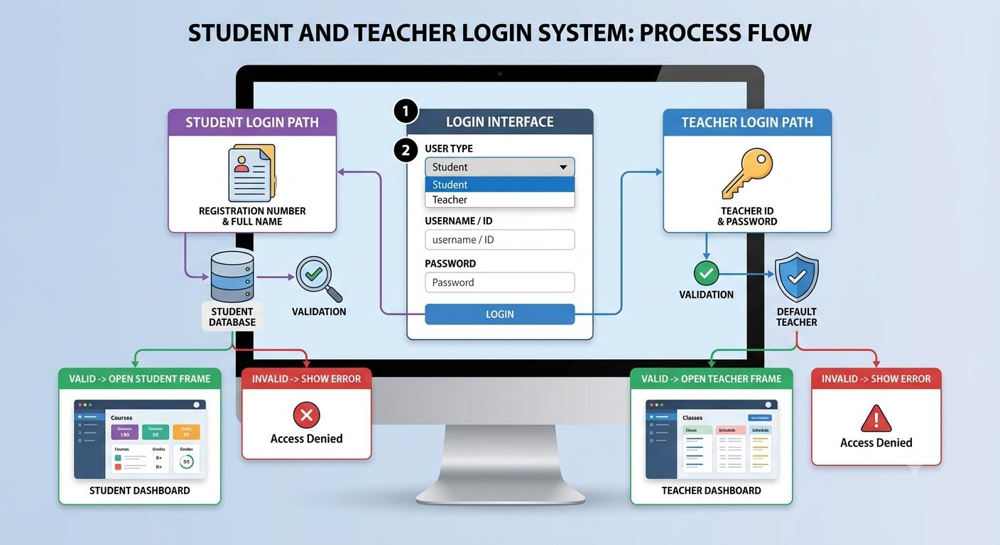

### 5.2 Quiz Taking Algorithm

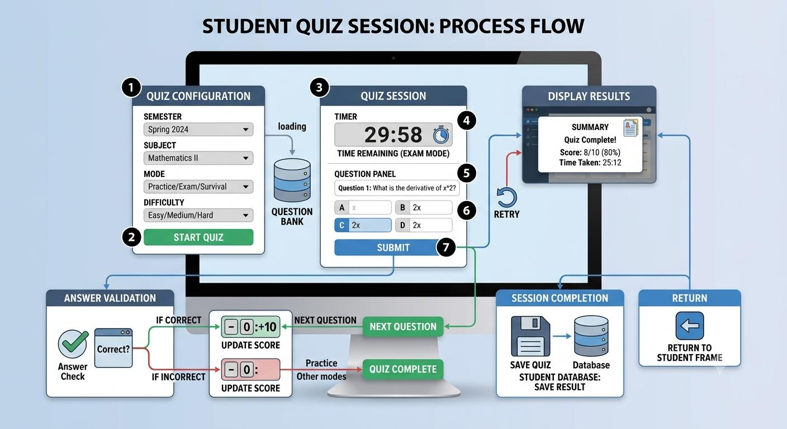

### 5.3 Question Import Algorithm

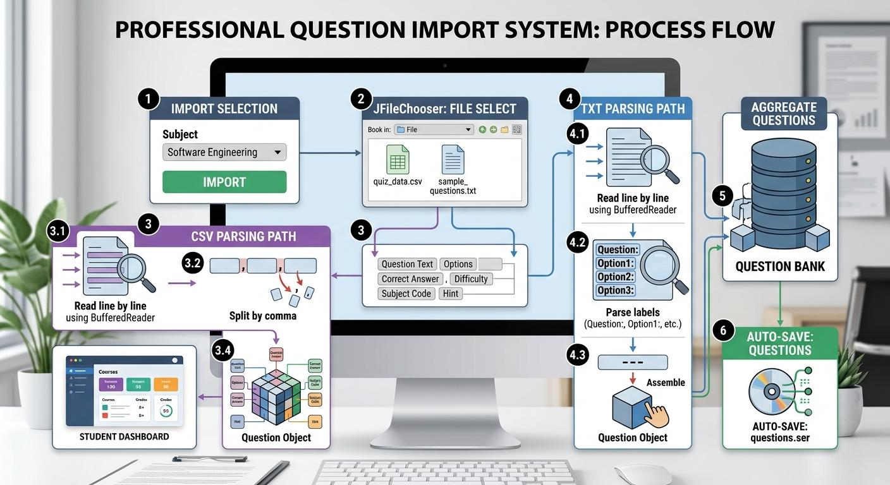

---

## 6. Implementation Details

### 6.1 Project Structure

```
src/
├── Main.java                  # Application entry point
├── models/                    # Data model classes
│   ├── Person.java            # Abstract base class
│   ├── Student.java           # Student entity
│   ├── Teacher.java           # Teacher entity
│   ├── Question.java          # Question entity
│   ├── QuizResult.java        # Quiz result entity
│   └── Subject.java           # Subject entity
├── interfaces/                # Interface contracts
│   ├── Gradable.java          # Score/Grade contract
│   └── Reportable.java        # Report generation contract
├── quiz/                      # Quiz mode implementations
│   ├── QuizSession.java       # Abstract quiz session
│   ├── PracticeMode.java      # Practice mode logic
│   ├── ExamMode.java          # Exam mode logic
│   └── SurvivalMode.java      # Survival mode logic
├── data/                      # Data storage classes
│   ├── StudentDatabase.java   # Student data management (Singleton)
│   └── QuestionBank.java      # Question management (Singleton)
├── filehandler/               # File operations
│   └── FileManager.java       # CSV/TXT import/export
├── gui/                       # GUI windows
│   ├── LoginFrame.java        # Login window
│   ├── StudentFrame.java      # Student dashboard
│   ├── TeacherFrame.java      # Teacher dashboard
│   └── QuizFrame.java         # Quiz taking window
└── utils/                     # Utility classes
    ├── AppConstants.java      # Constants (colors, fonts, messages)
    ├── DataPersistence.java   # Serialization (save/load)
    └── Validator.java         # Input validation
```

### 6.2 Key Implementation Details

| Topic | Details |
|---|---|
| **Singleton Pattern** | `StudentDatabase` and `QuestionBank` use the Singleton pattern so only one instance exists throughout the application. |
| **Data Persistence** | Data is stored using Java Serialization. `DataPersistence` handles saving and loading of all data. |
| **Timer Implementation** | `java.util.Timer` is used for countdown timers. A `TimerTask` runs every second to update the display. |
| **Event Handling** | `ActionListener` is used for button clicks and dropdown selections. Lambda expressions keep event handling concise. |
| **Duplicate Prevention (Students)** | Checked by registration number using `HashMap.containsKey()`. |
| **Duplicate Prevention (Quiz Results)** | Checked using `ArrayList.contains()` with an overridden `equals()` method. |

---

## 7. Installation & How to Run

### 7.1 Prerequisites

| Requirement | Details |
|---|---|
| **JDK** | Java Development Kit **17 or higher** (JDK 11 also works). Swing is part of the JDK, so **no external libraries are needed**. |
| **OS** | Windows, macOS, or Linux (with a desktop environment, since it is a GUI app) |
| **IDE (optional)** | IntelliJ IDEA, Eclipse, NetBeans, or VS Code with the *Extension Pack for Java* |

**Check that Java is installed:**

```bash
java -version
javac -version
```

If either command is not found, install a JDK:

- **Windows:** download from [Adoptium Temurin](https://adoptium.net/) or [Oracle JDK](https://www.oracle.com/java/technologies/downloads/), run the installer, and tick *"Set JAVA_HOME / Add to PATH"*.
- **Ubuntu/Debian:** `sudo apt install openjdk-17-jdk`
- **macOS (Homebrew):** `brew install openjdk@17`

### 7.2 Get the Project

```bash
git clone <your-repository-url>
cd quiz-exam-simulator
```

Or download the ZIP from GitHub, extract it, and open a terminal inside the extracted folder (the folder that contains `src/`).

### 7.3 Option A: Run from Command Line

> ⚠️ Run all commands from the **project root** (the folder that contains `src/`), so the `data/` folder is created in the right place.

**Windows (Command Prompt):**

```bat
mkdir out
dir /s /B src\*.java > sources.txt
javac -d out @sources.txt
java -cp out Main
```

**Windows (PowerShell):**

```powershell
mkdir out
javac -d out (Get-ChildItem -Path src -Recurse -Filter *.java).FullName
java -cp out Main
```

**Linux / macOS:**

```bash
mkdir -p out
javac -d out $(find src -name "*.java")
java -cp out Main
```

The login window should now appear. 🎉

### 7.4 Option B: Run in an IDE

**IntelliJ IDEA**
1. `File → Open…` and select the project folder.
2. Right-click the `src` folder → **Mark Directory as → Sources Root**.
3. Set the Project SDK: `File → Project Structure → Project → SDK` (JDK 17+).
4. Open `Main.java` and click the green ▶ **Run** button.

**Eclipse**
1. `File → Import → General → Existing Projects into Workspace` (or create a new Java Project and copy `src/` into it).
2. Right-click `Main.java` → `Run As → Java Application`.

**VS Code**
1. Install the *Extension Pack for Java*.
2. `File → Open Folder…` and choose the project folder.
3. Open `Main.java` and click **Run** above the `main` method.

### 7.5 Option C: Build a Runnable JAR (optional)

```bash
# after compiling into the out/ folder
echo "Main-Class: Main" > manifest.txt
jar cfm QuizExamSimulator.jar manifest.txt -C out .
java -jar QuizExamSimulator.jar
```

On most systems you can then simply double-click `QuizExamSimulator.jar`.

### 7.6 First Login

| Role | Credentials |
|---|---|
| **Teacher** | Teacher ID: `TCH001` · Password: `admin123` |
| **Student** | Registration Number + Full Name, **only after a teacher has added the student** |

**Suggested first-run steps:**

1. Choose **Login as: Teacher** at the bottom of the login window and sign in with `TCH001` / `admin123`.
2. In **Manage Students**, add a student (e.g. `F25605217`, `Abdul Rafay Akhtar`, Semester `1`).
3. In **Manage Questions**, add questions manually or import a CSV/TXT file (formats below).
4. Click **Logout**, choose **Login as: Student**, and sign in with the registration number and full name.
5. Pick Semester → Subject → Exam Mode → Difficulty and click **Start Quiz**.

> 💾 All data is auto-saved in the `data/` folder (`students.ser`, `questions.ser`). To reset the application, close it and delete those two files.

### 7.7 Question Import File Formats

**CSV format** (one question per line):

```
question,opt1,opt2,opt3,opt4,correctOption(1-4),difficulty,subjectCode,hint
```

Example:

```csv
Which keyword is used to inherit a class in Java?,implements,extends,inherits,super,2,Easy,CS201,Think about class-to-class relationships
What is the size of an int in Java?,2 bytes,4 bytes,8 bytes,16 bytes,2,Medium,CS101,It is a 32-bit type
```

**TXT format** (questions separated by `---`):

```
Question: text
Option1: text
Option2: text
Option3: text
Option4: text
Answer: 1-4
Difficulty: Easy/Medium/Hard
SubjectCode: code
Hint: text
---
```

Example:

```
Question: Which keyword is used to inherit a class in Java?
Option1: implements
Option2: extends
Option3: inherits
Option4: super
Answer: 2
Difficulty: Easy
SubjectCode: CS201
Hint: Think about class-to-class relationships
---
```

### 7.8 Troubleshooting

| Problem | Fix |
|---|---|
| `'javac' is not recognized` / `command not found` | JDK not installed or not on `PATH`. Reinstall the JDK and reopen the terminal. |
| `Error: Could not find or load main class Main` | Run from the project root and use `java -cp out Main`. Make sure compilation succeeded. |
| `class file has wrong version` | Compile and run with the same JDK version. |
| Student cannot log in | The teacher must add the student first; the name must match exactly. |
| `HeadlessException` on Linux server | Swing needs a display. Run on a desktop environment (not SSH without X forwarding). |
| Old or corrupted data | Close the app and delete `data/students.ser` and `data/questions.ser`. |

---

## 8. Sample Output

### 8.1 Login Window

| Student Login | Teacher Login |
|---|---|
| 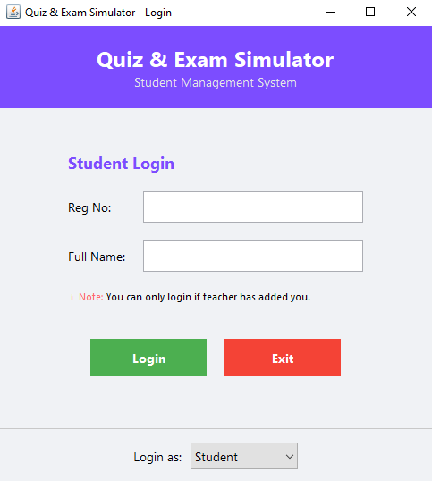 | 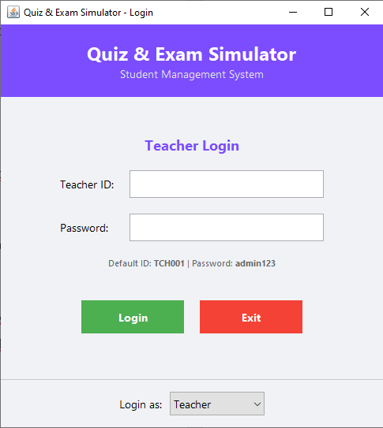 |

### 8.2 Teacher Dashboard: Manage Students

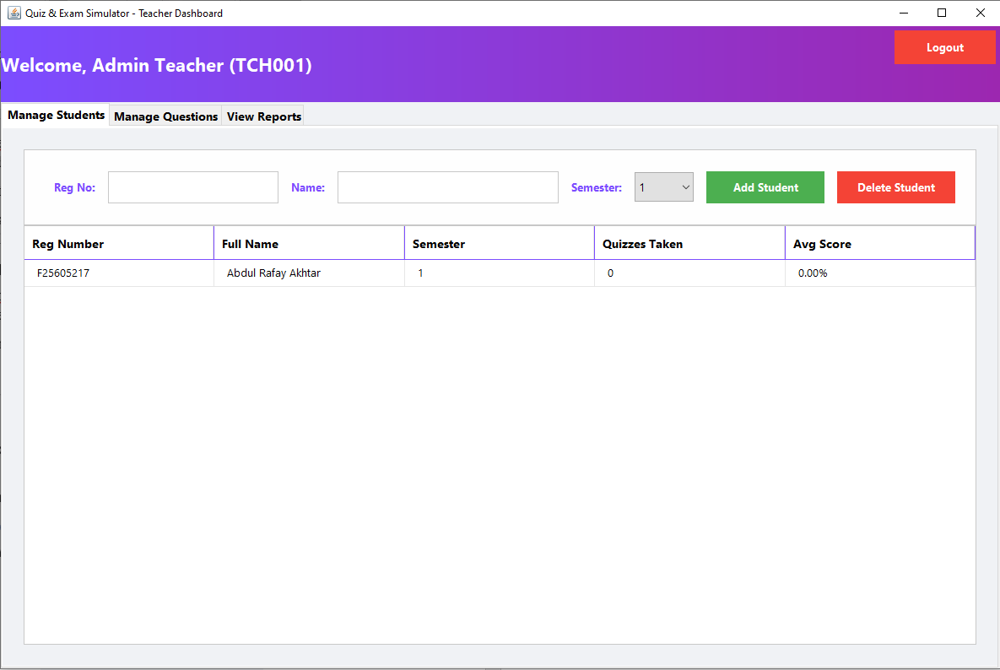

### 8.3 Teacher Dashboard: Manage Questions

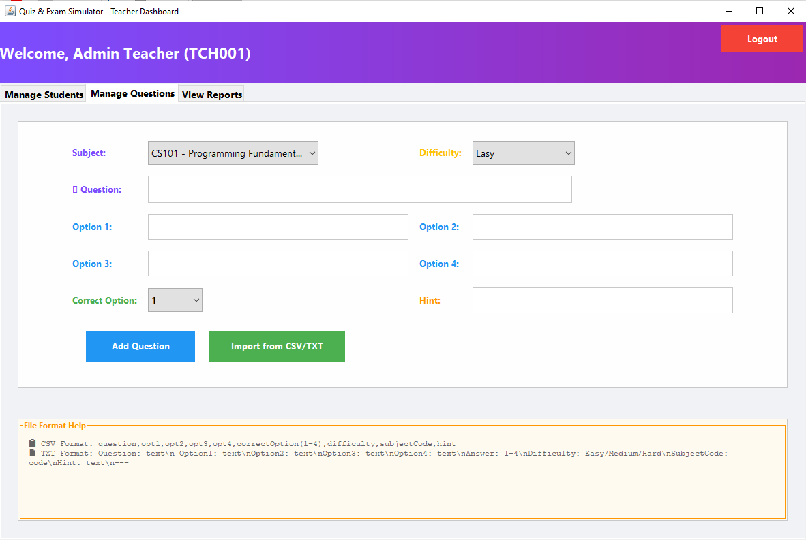

### 8.4 Quiz Window (Student Dashboard)

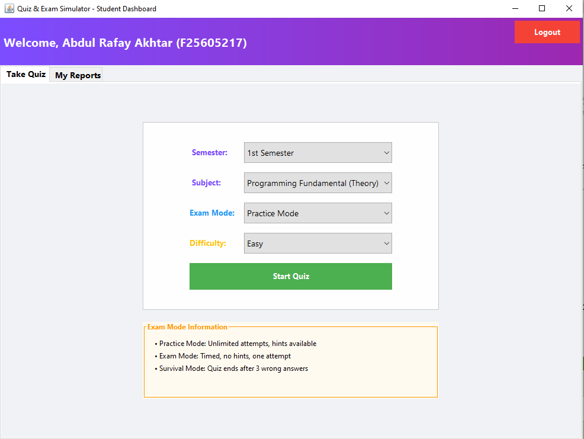

### 8.5 Quiz Result / Student Report

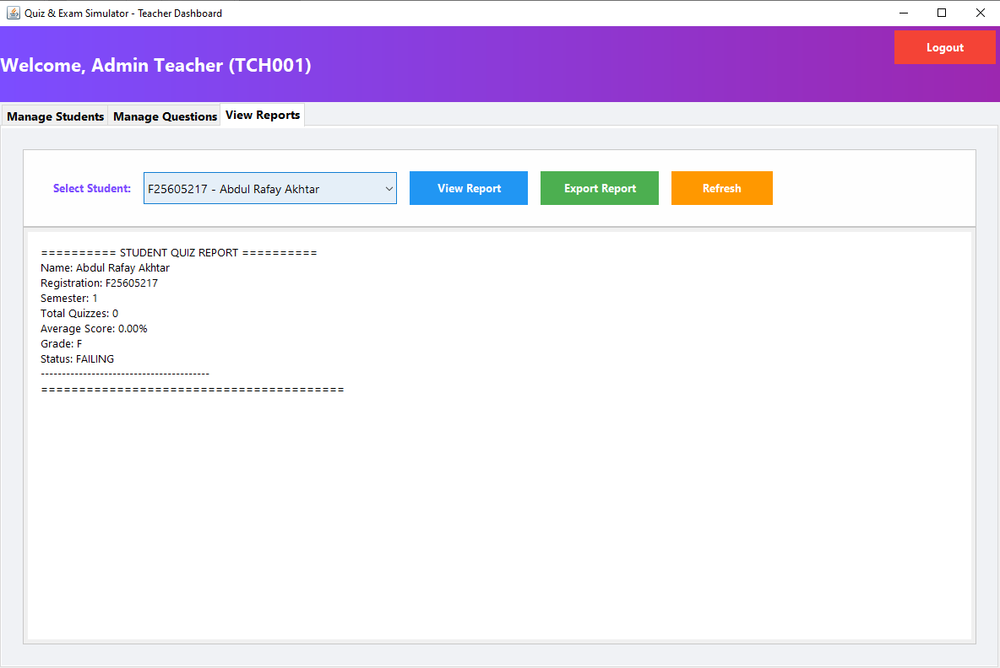

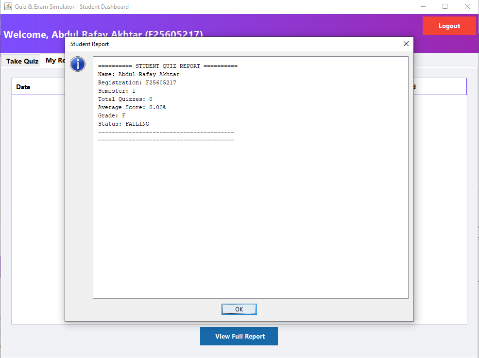

Sample report output:

```
========== STUDENT QUIZ REPORT ==========
Name: Abdul Rafay Akhtar
Registration: F25605217
Semester: 1
Total Quizzes: 0
Average Score: 0.00%
Grade: F
Status: FAILING
----------------------------------------
========================================
```

---

## 9. Conclusion

The Quiz & Exam Simulator is a fully functional desktop application that successfully demonstrates the implementation of core Object-Oriented Programming concepts. The project achieves all its objectives:

1. ✅ A user-friendly platform for quizzes and exams.
2. ✅ Efficient management of students and questions by teachers.
3. ✅ Three different quiz modes for varied learning experiences.
4. ✅ Instant feedback on quiz performance.
5. ✅ Comprehensive quiz history and report generation.
6. ✅ Practical application of OOP concepts.
7. ✅ Data persistence through file handling.
8. ✅ A professional GUI using Java Swing.

---

## 10. Future Enhancements

| Feature | Description | Priority |
|---|---|---|
| Password Encryption | Store hashed passwords instead of plain text | 🔴 High |
| Database Integration | Replace file-based storage with MySQL/PostgreSQL | 🔴 High |
| Email Notifications | Send quiz results to student emails | 🟡 Medium |
| Leaderboard | Display top scores across all students | 🟡 Medium |
| Analytics Dashboard | Charts and graphs for performance tracking | 🟡 Medium |
| PDF Export | Export reports as PDF instead of text files | 🟡 Medium |
| Dark Mode | Add dark theme option for better UX | 🟢 Low |
| Sound Effects | Play sounds for correct/wrong answers | 🟢 Low |

---

<div align="center">

**THE END**

Made with ☕ and Java at the National University of Technology (NUTECH), Spring 2026

</div>
